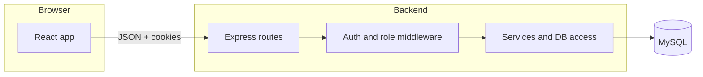

# Banking loan management

A full-stack web app for running **loan operations inside a bank context**: who the institution is, where branches sit, who the customers are, which loan products exist, how applications become active loans, and how repayments, penalties, and ledger entries are tracked over time.

If you picture a day in the life of a small loan team, this system is the digital desk where they maintain that story from setup to collections.

---

## What lives in this repository

| Folder | Role |
|--------|------|
| **`frontend/`** | React (Vite) single-page app: login, dashboard shell (sidebar + navbar), and screens for each business area. It talks to the API over HTTP and keeps JWTs in cookies. |
| **`backend/`** | Node.js + Express REST API, MySQL persistence, JWT auth, optional Swagger docs, and email configuration for outbound mail. |

You typically run **both** during development: the browser UI on one port and the API on another.

---

## How the pieces talk to each other



1. The **React app** is served by Vite in development (commonly `http://localhost:5173`).
2. **Axios** sends requests to the API base URL (in code this is `http://localhost:3000`). The backend enables **CORS** for that origin and allows **credentials** so cookie-based auth can work if you extend it that way; today the app mainly stores tokens with `js-cookie` and sends the **access token** in the `Authorization: Bearer ...` header.
3. **Express** matches URL prefixes (`/banks`, `/customers`, `/loans`, and so on) to route modules, then **controllers** call **services** that run SQL against **MySQL**.

---

## User journey: from open tab to daily work

### 1. Landing and login

You open the app at `/`. You see the **login** screen (wrapped so logged-in users are steered away from signing in again when that logic applies).

You submit **email and password**. The client calls `POST /auth/login`. On success, the API returns **access** and **refresh** tokens; the UI stores them in cookies and navigates to **`/dashboard/home`**.

### 2. “Are you really logged in?”

Routes under `/dashboard/*` are wrapped in a **guard** that calls `GET /auth/me` with the access token. If the server accepts it, you see the dashboard. If not, you are sent back to `/`.

So the flow is: **credentials → tokens → every protected visit is re-validated via `/auth/me`**.

When the **access token** expires, the client can call **`POST /auth/refreshToken`** with **`refresh_token`** in the body; the server returns a **new access token** so the user can keep working without logging in again.

### 3. Inside the dashboard

The **dashboard** is a layout: **sidebar** (navigation), **navbar**, and a **main** area where the active route renders (`Outlet` in React Router).

The sidebar mirrors the business domains: customers, banks, branches, loans, products, applications, installments, payments, penalties, ledger, roles, users, and a home view.

### 4. Who can do what on the server

Many write/read routes are protected with **JWT** (`authMiddleware`) and then restricted to **`Admin`** or **`Manager`** roles via **`authorize(...)`** (see `backend/src/middlewares/roleMiddleware.js`). The database links users to roles through **`tbl_user_branch_role`**.

In plain language: **not every token automatically means full power**; the API checks role names before several operations.

---

## Business flow: a sensible order to think about the data

You do not have to use the UI in this exact sequence, but this is the **story the model tells**:

1. **Banks and branches**  
   Define the institution (`tbl_banks`) and its locations (`tbl_branches`). Branches anchor a lot of “where did this happen?” context.

2. **Roles and users**  
   Roles (`tbl_roles`) describe job types. Users (`tbl_users`) are staff accounts. Assignments tie a user to a branch and role (`tbl_user_branch_role`) so the backend can decide if someone is Admin/Manager for protected routes.

3. **Customers**  
   People or entities you lend to (`tbl_customers`, with phone data in `tbl_phones` when used).

4. **Loan products**  
   Reusable definitions: what kind of loan you sell (`tbl_loan_products`).

5. **Loan applications**  
   A customer’s request before it is a live facility (`tbl_loan_application`).

6. **Loans**  
   The actual booked loan (`tbl_loans`) linking customer, product, amounts, and lifecycle (including closure when supported).

7. **Installments**  
   The repayment schedule (`tbl_loan_installment`).

8. **Payments**  
   Money received against the loan (`tbl_loan_payment`).

9. **Penalties**  
   Extra charges when rules say so (`tbl_penalties`).

10. **Ledger and transactions**  
    Accounting-style records (`tbl_ledger`, `tbl_transactions`) for tracing financial movement.

The **frontend** screens are named to match these steps (add/list/edit patterns). The **backend** mirrors that with matching route groups under `server.js`.

---

## API map (prefixes)

Mounted from `backend/src/server.js` (all relative to the server root URL, e.g. `http://localhost:3000`):

| Prefix | Typical purpose |
|--------|------------------|
| `/auth` | Login, refresh token, current user (`/me`). |
| `/banks`, `/branches` | Institution structure. |
| `/roles`, `/users` | Access control and staff users. |
| `/customers` | Borrower master data. |
| `/loanProducts` | Product catalog. |
| `/applications` | Loan applications. |
| `/loans` | Active loans. |
| `/installments` | Schedules. |
| `/loanPayments` | Payments. |
| `/penalties` | Penalties. |
| `/ledgers` | Ledger entries. |
| `/transactions` | Transactions. |
| `/api-docs` | **Swagger UI** for exploring documented endpoints. |

Exact paths and verbs are defined per file in `backend/src/routes/`.

---

## Standard JSON shape

Successful API payloads often follow a small wrapper from `backend/src/constants/response.js`: **`rescode`**, **`status`**, **`message`**, and **`data`**. Your UI already expects nested **`data`** for login tokens (`res.data.data.accessToken`, etc.). When integrating new screens, match whatever shape each controller returns.

---

## Running the project locally

### Prerequisites

- **Node.js** (LTS recommended)  
- **MySQL** with a database created for the app (name should match your config)

### Backend

```bash
cd backend
cp .env.example .env
# Edit .env: DB_*, secrets, email if you use mail features
npm install
npm run dev
```

The server listens on **`PORT`** from `.env` (or **3000** by default).

### Frontend

```bash
cd frontend
npm install
npm run dev
```

Vite prints the local URL (often **5173**). The backend is already configured to trust **`http://localhost:5173`** for CORS.

### Environment variables

**Never commit `.env`.** Use **`backend/.env.example`** as the checklist of required keys. Optional notes for the SPA live in **`frontend/.env.example`**.

---

## Security and GitHub

- **`.gitignore`** files ignore **`node_modules/`** and **`.env`** (while keeping **`.env.example`** available).  
- Rotate any secrets that were ever committed before you publish the repo.  
- For production, use strong random secrets for JWT-related env vars and lock down MySQL users to least privilege.

---

## Tech stack (short)

**Frontend:** React 19, React Router 7, Vite, Tailwind CSS 4, Axios, js-cookie, Lucide / React Icons.  

**Backend:** Express 5, `mysql2`, `jsonwebtoken`, `bcrypt` / `bcryptjs`, `cors`, `dotenv`, Swagger UI, `nodemailer`.

---

## Where to look in code

| If you want to understand… | Start here |
|----------------------------|------------|
| All UI routes | `frontend/src/App.jsx` |
| HTTP client and auth header | `frontend/src/services/api.js` |
| Dashboard navigation | `frontend/src/components/SideBar.jsx` |
| API entry and mounts | `backend/src/server.js` |
| DB connection | `backend/src/configs/db.js` |
| Login and tokens | `backend/src/controllers/authController.js` |
| Table name constants | `backend/src/constants/tableNames.js` |

---

This README is meant to be a **map**, not a legal contract of every edge case. When in doubt, follow the route from `server.js` into the matching `routes` → `controllers` → `services` file for the behavior of a single feature.
